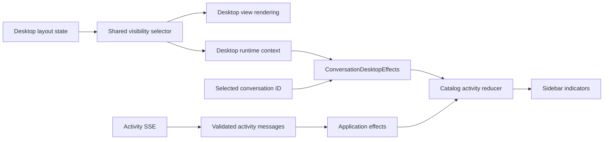

# Conversation frontend vocabulary

These terms describe frontend responsibilities. They do not require matching
backend classes or separate network channels.

- **Stream envelope:** One record yielded by the `/api/chat` response. It
  contains transport metadata and a nested event payload.
- **Conversation event:** The canonical, flat event shape interpreted by the
  frontend. Live stream envelopes are normalized into this shape; saved events
  already use it.
- **Transcript:** The ordered user prompts and agent results shown in the main
  conversation view. It includes completed and in-progress output, file
  results, and compaction markers. It is a UI model derived from conversation
  events, not the raw event list or an agent's activity log.
- **Turn:** One root-agent run in the transcript, normally beginning with a
  user prompt. A turn contains ordered transcript items such as iterations,
  file results, and compaction markers.
- **Conversation session:** State for the open conversation, including its ID,
  draft, stream lifecycle, pending input, and the event records needed to build
  the transcript.
- **Agent model:** Agent identities, parent-child relationships, lifecycle
  status, context usage, and sub-agent activity.
- **Agent activity:** The ordered work attributed to one agent, such as
  reasoning, content, tool calls, spawned agents, file results, and errors. It
  powers the agent network and detail views and is separate from the main
  transcript.
- **Workspace model:** Browser, terminal, file, generation, and remote-desktop
  state associated with a conversation and its agents.
- **Application effect:** A typed, one-time notification such as requesting
  audio playback or refreshing a resource list. Effects can originate from
  any feature; restoring saved conversation events does not repeat them.

Root-agent activity is projected from its transcript turn instead of retained
twice. Sub-agent output is excluded from the main transcript and remains in the
agent model for the network activity view.

## Ownership and flow

`ConversationCatalogProvider` owns conversation lists, list mutations, and browser-session
run activity (running indicators and unseen-completion dots).
`ConversationSessionProvider` owns the open conversation and its commands.
`AgentProvider` owns the agent graph and sub-agent activity. `WorkspaceProvider`
owns browser, terminal, file, generation, and desktop data by agent.
`AppEffectsProvider` delivers typed one-time effects to feature owners without
retaining them as global state. `AudioPlayer` subscribes to playback effects
and owns its transient player state locally.
`DesktopNavigationProvider` translates named navigation commands directly into
Desktop View commands; it owns no parallel current-location state.
`useDesktopLayout` owns two equivalent tab groups, View placement and focus,
the horizontal split ratio, floating placement, and fullscreen presentation.
The focused View supplies the current navigation target. Each View has one
stable host even when it moves between tab groups. Custom Apps and Workspace
resources retain their domain data in their own owners and contribute
serializable View descriptions to Desktop Layout. `App` assembles setup, these
state owners, and `Desktop`.

Live data follows this path:

```text
/api/chat
  → chatClient (request and JSONL stream)
  → normalizeLiveEvent (canonical conversation event)
  → mapConversationEventToActions
      ├── session reducer actions
      ├── agent reducer actions
      ├── workspace reducer actions
      └── application effects (live delivery only)
```

Restoration reads saved canonical events and calls the same
`mapConversationEventToActions` function. Saved browser and terminal snapshots
and preview metadata become explicit workspace restore actions. Restoration
ignores application effects.

Desktop features navigate through commands such as `openConversation`,
`openAgent`, and `openSettings`. Sidebar reads that navigation owner directly
instead of sending generic panel identifiers through Desktop. Desktop
interprets navigation targets as Views to open or select in the left tab group;
any View can subsequently move to either tab group. Navigation targets and
Views contain stable IDs and serializable metadata rather than React content.
There is no URL synchronization yet; a future router can implement the same
navigation-target interface without changing feature components.

## Activity and desktop visibility

`ActivityStreamProvider` in `features/app` opens one `/api/chat/activity` SSE
connection through `activityStream`. Each message is validated against the
generated activity message types before it becomes an application effect:
`runs/snapshot`, `runs/started` and `runs/finished` for run identities, and
`goals/snapshot` and `goals/changed` for goals. The catalog's
`useConversationActivity` subscribes to the run effects and feeds
`activityReducer`; the goals state subscribes to the goal and run effects. The
messages, decoder and reducer are included in the frontend TypeScript
checking boundary. Native EventSource reconnects automatically; each
connection starts with snapshots. Browsers can give up on a connection while a
phone has the page paused, so the app opens a new one when the page becomes
visible again or the browser comes back online and the old one has closed. The server caps each subscriber at 128
pending updates and closes the connection on overflow or a socket write taking
longer than 30 seconds. Disconnect cleanup removes observers without stopping
runtime-owned work. The reducer reconciles known runs without restoring
historical completion dots on a fresh page load. Invalid messages are reported
to the console and rejected whole, leaving the last valid state intact.

Desktop visibility is derived from layout state by `visibleViewIds`, shared by the
renderer and `DesktopViewRuntimeProvider`. `useVisibleViewIds` exposes that result
separately from keyboard focus. Active tabs in displayed panes and floating views
are visible; fullscreen exposes only its view. Mobile suppresses a second pane.
This describes app layout visibility, not browser-tab visibility or user attention.

`ConversationDesktopEffects`, installed in `DesktopDomainEffects`, combines those
view IDs with the selected conversation ID. Chat and agent-network modes both
show the selected conversation. It supplies that visible conversation ID (or null)
to catalog activity before paint. The session does not infer visibility from
selection, and rendered chat components do not register themselves.



A run finishing while its conversation is visible clears the spinner without
adding a dot. A hidden completion adds a dot, even if the session is still
selected. Showing that conversation clears the dot. These visibility updates do
not change the selected transcript connection or stop server runs.

## Transcript display steps

`projectTurns` first turns events into transcript items, in the order they
happened. Goal events that the transcript shows become goal dividers through
`goalDividerItem`; other goal events add nothing. Then display steps run on the
finished turns in a fixed order, listed in `TRANSCRIPT_PASSES`: compaction
markers move to the boundary between summarized and kept work, and day headers
mark each change of day in a chat that has a goal. Each step returns new turns
and never changes the events.

## Queued messages

Chat state owns the messages waiting for the agent's next step. Sending while
the agent works queues the message on the server, and the run's queue events
add it to the queue and take it out when the agent reads it. The queue rules
live in `session/queueState.js` as pure functions the session reducer calls.
Queue events replay with the run and are not saved in the chat. A message the
run hands back unread returns to the composer.
